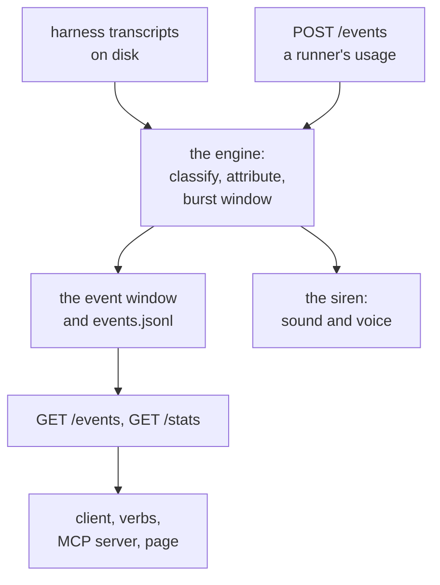

# API

Every interface by which bmo-cache-siren meets anything outside its own process: the HTTP API it
serves, its pages, the client, the command-line verbs and the harness plugin built on that client, and
the files it reads. The OpenAPI 3.1 document `docs/openapi.json` states the same API as a contract; it
is generated from the service's own types (`bmo-cache-siren openapi`), and a test fails where the
committed document differs from what the code writes.

## Versioning

The version is the one in `Cargo.toml`. Until the first release it is `0.1.0` and counts revisions:
`0.1.0` was the base, every later version bump is one revision written `0.1.0-rev.<n>`, and major,
minor and patch never move, whatever the change. Any change to a contract stated here (a route, a
query parameter, a body or response field, its type or meaning, an error code, an event kind) raises
the revision by one, and this document changes with it in the same commit. `GET /health`, the
OpenAPI document, the TypeScript package and the MCP server all answer the same version.

## The unit

- **An upstream.** A harness takes it as an MCP server with no other service running. It knows no
  caller: a posted request is grouped by the caller's opaque `scope`, attributed by `actorName` and
  carries the caller's `labels`, and nothing in the service reads any of them.
- **It calls no other service.** It reads the harness transcripts on its own disk and takes the
  usage a runner posts; nothing else comes in, and nothing goes out but its answers and its siren.
- **One resource per route**, in the common wire format: camelCase keys, times as integers of epoch
  milliseconds, a page as `{"items": [...], "more": boolean}`, and every failure as a non-2xx status
  with a body of exactly `code` and `error`.

## Access

- **Address.** The server listens on `127.0.0.1` at the configured `port` (default 9022). The API has
  no prefix and no version in its paths.
- **Token.** Every API route takes a bearer token, `Authorization: Bearer <token>`. A reader that
  cannot set a header, a browser's `EventSource` among them, gives it as the `access_token` query
  parameter instead (RFC 6750, section 2.3). The token is the content of the token file, `token` in
  the data directory unless `--token-file` names another; the daemon writes a new random one, readable
  by its user alone, when the file is missing.
- **Pages.** The pages and their assets (below) take no token: the live page reads it from its own
  address's fragment, which `bmo-cache-siren page` prints.
- **Bodies.** A body is JSON, at most 65536 bytes. Every JSON answer is UTF-8 with
  `Cache-Control: no-store`.

## Errors

| Status | `code` | When |
| --- | --- | --- |
| 400 | `bad-request` | the body or the query is not the shape the route takes; the sentence names what is wrong |
| 401 | `unauthorized` | the token is missing or wrong |
| 404 | `no-route` | no route answers this method and path |
| 404 | `not-found` | a page asset that is not there |
| 409 | `conflict` | a settings change the settings as they stand do not allow |
| 410 | `gone` | a resume from before the event window |
| 413 | `too-large` | the body is over 65536 bytes |
| 500 | `failed` | the service failed; the sentence is the failure |

Each route below lists the codes of its own; `unauthorized`, `no-route`, `too-large` and `failed` can
answer any of them.

## Health

`GET /health` answers `ready` (true once the daemon serves), `reason` (null when ready) and `version`.

## Events

The service's one stream and its record of what happened, kept as events of three kinds:

| Kind | `data` | When |
| --- | --- | --- |
| `usage.created` | a Usage | a request, a limit, a notice, a command or a compact read from a transcript, or a usage posted to `POST /events` |
| `siren.sounded` | a Siren | a red request or a burst raised the siren, outside its cooldown |
| `settings.changed` | the Settings | a `PATCH /settings` changed something |

An event is `{"id", "kind", "at", "data"}`: `id` is the event number, which only grows and carries on
across restarts; `at` is when it happened, a Usage's own `at` and otherwise when it was recorded. A
Usage read late, such as one loaded at start, can carry an earlier `at` than an event numbered before
it.

### The window

- The service keeps the newest `ring` events (600 by default) in memory, and every event in
  `events.jsonl` for `retention_days`. At start the window is restored from the event log, and
  numbering carries on past the highest number in it.
- A resume from before the window (`after` lower than the first event held less one) is answered
  410 `gone`; the reader reads the page again without a cursor.

### GET /events

| Query | Meaning |
| --- | --- |
| `after` | an event number: only events after it |
| `kinds` | a comma-separated list of the kinds above; any other name is `bad-request` |
| `sessionId` | only the events of this session: a Usage, or a Siren of one session |
| `limit` | 1 to 1000; 100 where absent (the page only) |
| `access_token` | the token, for a reader that cannot set a header |

- **The stream.** By default the answer is server-sent events, held open until the reader leaves.
  Each event's SSE `event` is its kind, its `id` the event number and its `data` the whole event.
  It starts after `after`, or after `Last-Event-ID`, or where no cursor is given with the next event
  recorded. A comment line every fifteen seconds keeps it open.
- **The page.** A reader asking `Accept: application/json` is answered a page instead. With `after`
  it holds the first `limit` events past it, oldest first, and `more` says whether more stand past
  the last. Without it the page holds the newest `limit` events, oldest first, and `more` is false.

Codes: `bad-request`, `gone`.

### POST /events

A runner whose harness leaves no transcript posts the usage of one model request. The body:

| Field | Type | Rule |
| --- | --- | --- |
| `sessionId` | string | required, non-blank, up to 500 characters |
| `modelName` | string | required, non-blank, up to 500 characters |
| `cachedTokenCount` | integer | required, at least 0: tokens read from the cache |
| `newTokenCount` | integer | required, at least 0: input and cache-write tokens |
| `at` | integer | required, at least 0: when the request went out |
| `cacheWriteTokenCount` | integer | at least 0 and at most `newTokenCount`; 0 where absent |
| `outputTokenCount` | integer | at least 0; 0 where absent |
| `harnessName` | string | up to 500 characters: the harness that sent it, such as `codex` |
| `projectName` | string | up to 500 characters; the scope where absent |
| `directoryName` | string | up to 500 characters |
| `scope`, `actorName` | string | up to 500 characters each; the caller's own, never read |
| `labels` | object of strings | the caller's own, never read |

Any other field is `bad-request`. The answer is 201 with the `usage.created` event. The posted request
is classified as a transcript request is: a session is seen once the window holds a Usage of the same
harness, session and model; a seen session that read nothing back and took `yellow_new_tokens` or
more new tokens is `cold`; one that read from the cache is `warm` or `growth`; an unseen one is
`start`; a seen one under the yellow line that read nothing is `request`. Its `gapMs` is the time
since that session's previous Usage in the window.

Codes: `bad-request`.

### Usage

| Field | Type | Meaning |
| --- | --- | --- |
| `sessionId` | string | the harness session |
| `modelName` | string | the model identifier |
| `modelLabel` | string | its readable name |
| `at` | integer | when the request went out, else when the line was read |
| `harnessName` | string | `claude-code` for a transcript, else what the poster gave or empty |
| `backend` | string | `anthropic`, `local`, `openai` or `openrouter` |
| `kind` | string | `warm`, `growth`, `start`, `cold`, `refusal`, `quota`, `compact`, `error`, `notice`, `cmd`, `request` |
| `level` | string | `info`, `yellow` or `red` |
| `note` | string | a cause (`session_start`, `model_switch`, `effort_model`, `compact`, `ttl_expired`, `prefix_changed`, `tool_search`, `image`, `unknown`), or the text of a notice, an error, a limit or a command |
| `newTokenCount` | integer | input and cache-write tokens |
| `inputTokenCount`, `cacheWriteTokenCount`, `cachedTokenCount`, `outputTokenCount` | integer | the four counts the provider gave |
| `contextTokenCount`, `previousContextTokenCount` | integer | this request's context and the session's previous one |
| `gapMs` | integer or null | time since the session's previous request |
| `costUsd` | number | estimated USD for Anthropic models, 0 otherwise |
| `projectName` | string | a transcript's project folder with any configured prefix cut, or what the poster gave |
| `directoryName` | string | the last part of the working directory |
| `subagent` | boolean | the transcript is a subagent's |
| `parentSessionId` | string or null | a subagent's parent session |
| `requestLabel` | string | a short label of what prompted the request |
| `scope`, `actorName` | string or null | as posted |
| `labels` | object | as posted; empty for a transcript |

A local backend bills nothing, so its level never goes above yellow.

### Siren

| Field | Type | Meaning |
| --- | --- | --- |
| `kind` | string | the red request's kind (`cold`, `growth`, `refusal`), or `burst` |
| `at` | integer | when it was raised |
| `sessionId` | string or null | the request's session; null for a burst |
| `projectName` | string | the request's project, or the burst's largest owners, comma-joined |
| `newTokenCount`, `cachedTokenCount` | integer | the request's, or the burst window's sums |
| `requestCount` | integer | 1, or the requests in the burst window |
| `note` | string | the request's cause, or `<N> req in <W>s` |
| `parts` | array | a burst's projects, largest first: `projectName`, `newTokenCount`, `cachedTokenCount`, `requestCount` |
| `audible` | boolean | whether sound or voice went out: the siren is armed and `sound` or `voice` is on |

A red request raises the siren once per session per `siren_cooldown_s`; a burst, whenever the new
tokens of the last `burst_window_s` reach `burst_red_tokens` and the last burst is a window ago.

## Stats

`GET /stats` sums the window's Usage by session.

| Query | Meaning |
| --- | --- |
| `since` | only events at or after this time; the oldest event held where absent |
| `sessionId` | only this session |

The answer: `since` (the time the sums start), `sirenCount` (Siren events since then, of the session
where one is named) and `sessions`, the latest first, each:

| Field | Meaning |
| --- | --- |
| `sessionId`, `projectName`, `harnessName`, `modelName` | the session, as its latest Usage gives them |
| `requestCount` | Usages with any token count |
| `newTokenCount`, `cachedTokenCount`, `outputTokenCount` | their sums |
| `cachedShare` | cached over cached and new tokens, 0 to 1; null with neither |
| `coldCount` | its `cold` requests |
| `firstAt`, `lastAt` | its first and latest Usage |

Codes: `bad-request`.

## Settings

The siren's switch, the cache lifetime it assumes and its threshold: `armed` (boolean), `ttlMs` (the
cache lifetime for a harness the per-harness table does not list) and `threshold` (the new tokens that
make a cold or growth request red).

- **`GET /settings`** answers them.
- **`PATCH /settings`** takes a merge patch of any of the three; a field given as null or left out
  stays. `ttlMs` and `threshold` are integers above 0. A threshold at or under `yellow_new_tokens` is
  refused 409 `conflict`. The change applies at once, is written into the config file the daemon was
  started with (`armed`, `ttl_s` and `red_new_tokens`, every other key left as written, a symbolic
  link written through), and records a `settings.changed` event when anything changed. When the file
  cannot be written the change still holds and the answer is 500 `failed`.

An unarmed siren still raises its Siren events, with `audible` false. The per-harness lifetimes
(`ttl_by_mode_model_s`) stay in the config file (`docs/configuration.md`).

Codes: `bad-request`, `conflict`.

## Siren tests

`POST /siren-tests` takes no body and sounds the siren and the voice once as a red cold alert,
whatever the cooldown. It keeps nothing and records no event. The answer is 200 with `sounded`
(whether sound or voice went out) and `at`.

## Pages

Outside the API, served with no token:

- **`GET /`**: the live page, `web/index.html`. It reads the token from its address's fragment
  (`#access_token=<token>`), keeps it for the browser tab, reads the newest events as a page, then
  follows the stream. Its header shows the new tokens of the last minute, a ten-minute sparkline and
  the sessions of the last 30 minutes, all summed from the events it holds; its buttons arm or quiet
  the siren, show or leave out local-backend rows (kept in the browser) and hide the overlay window.
- **`GET /demo`**: the demo page, `web/demo.html`, drawing fixed sample rows without the daemon's data.
- **`GET /asset/{name}`**: `siren_on.png` or `siren_off.png` from the data directory, as `image/png`,
  for the mute button. Neither ships with the repository; a missing one, or any other name, is 404
  `not-found`, and the page then shows a glyph in its place.

## The client

The service publishes its client in two languages, both from `docs/openapi.json`:

- **Rust:** the `client` module of the `cache_siren` library, one blocking call per route with the
  wire types of the `wire` module. A refusal comes back with its status, `code` and `error`.
- **TypeScript:** the `bmo-cache-siren-client` package in `package/`: the types `openapi-typescript`
  generates (`openapi.d.ts`, held to the document by a test) and a client over `openapi-fetch` that
  sends the token on every call.

## The command

`bmo-cache-siren <verb>`; every verb but `serve`, `mcp`, `openapi`, `page`, `restart` and `log` calls
the API through the Rust client, and with `--json` prints the member or page exactly as the API
answers it.

| Verb | Does |
| --- | --- |
| `serve` | runs the daemon (`docs/configuration.md`) |
| `status` (no verb) | the health, the settings and the sessions of the window, on one line |
| `tail [N]` | the newest N events, 20 by default |
| `stats [--since <ms>] [--session <id>]` | the sums by session |
| `settings [--armed <bool>] [--ttl-ms <ms>] [--threshold <n>]` | reads the settings, or changes the ones given |
| `mute`, `unmute` | quiets or arms the siren |
| `test` | sounds the siren once |
| `page` | prints the live page's address with the token in its fragment |
| `mcp` | runs the MCP server |
| `openapi` | prints the OpenAPI document |
| `restart` | restarts the daemon under launchd on macOS, systemd --user elsewhere |
| `log [N]` | the last N lines of the daemon's log, 30 by default |

Every verb takes `--address` (`CACHE_SIREN_ADDRESS`, default `http://127.0.0.1:9022`), `--token`
(`CACHE_SIREN_TOKEN`), `--token-file` (`CACHE_SIREN_TOKEN_FILE`) and `--data-dir`
(`CACHE_SIREN_DATA_DIR`); a client's token is `--token`, else the token file's content.

## The harness plugin

`bmo-cache-siren mcp` runs an MCP server on standard input and output, reaching the service at
`--address` with the client's token. Its plugin is the `bmo-cache-siren` skill in
`skills/bmo-cache-siren/`. Each tool is one call of one route through the Rust client:

| Tool | Route | Input |
| --- | --- | --- |
| `cache_stats` | `GET /stats` | `since`, `sessionId` |
| `cache_settings` | `GET /settings` | none |
| `cache_settings_update` | `PATCH /settings` | `armed`, `ttlMs`, `threshold` |
| `cache_events` | `GET /events`, as a page | `after`, `limit` |

A harness reads how well its own prompt cache is holding with `cache_stats` and widens or narrows the
siren with `cache_settings_update`. A refused call is a tool error whose text is the service's status,
`code` and `error`.

## Files read

### Transcript roots

Each glob in `projects_globs` (with `~` expanded) that names a directory is a root. Under each root
the siren tails `<project>/<session>.jsonl` and `<project>/<session>/subagents/<agent>.jsonl` whose
modification time is within `recent_hours`. These are the Claude Code CLI's own transcript lines,
read and never written. It reads:

- assistant lines: `timestamp`, `cwd`, `isApiErrorMessage`, and from `message` the `id` (one
  request), `model`, `content` (tool names, ToolSearch) and `usage` (`input_tokens`,
  `cache_creation_input_tokens`, `cache_read_input_tokens`, `output_tokens`); a `<synthetic>` model
  line is a notice, a limit or an error;
- system lines with subtype `model_refusal_fallback` (`originalModel`, `fallbackModel`,
  `apiRefusalCategory`, `scope`), `local_command` (`content`, for `/model` and `/effort`) and
  `compact_boundary`;
- summary lines, as a compact;
- user lines, for the request label, images and tool results.

Offsets are kept in the data directory, so a restart resumes where it stopped.

## Voice and sound

On a raised siren, when it is armed:

- when `sound` is true, the player plays `siren_file` (with `~` expanded) if that file exists, else
  the generated `siren.wav` in the data directory. The player is `siren_player` where the config
  gives one; otherwise `afplay` on macOS, and elsewhere the first of `pw-play`, `paplay` and `aplay`
  found on the `PATH`. A host with none logs the failure and stays silent.
- when `voice` is true and `voice_cmd` is a non-empty argument list, it is run with every `{text}`
  in each argument replaced by the English alert text. Neither output is read.

## Data directory

`~/.claude/cache-siren`, or the directory `--data-dir` names (`docs/configuration.md`), holds the
event log `events.jsonl` (one event per line, pruned to `retention_days`; a line of any other shape is
skipped and pruned), `state.json` (transcript offsets), `token` (the bearer token),
`cache-siren.log` (structured lines, cut to its last 4 MB past 8 MB), the generated `siren.wav` and the
optional page images. Only the siren writes it.
